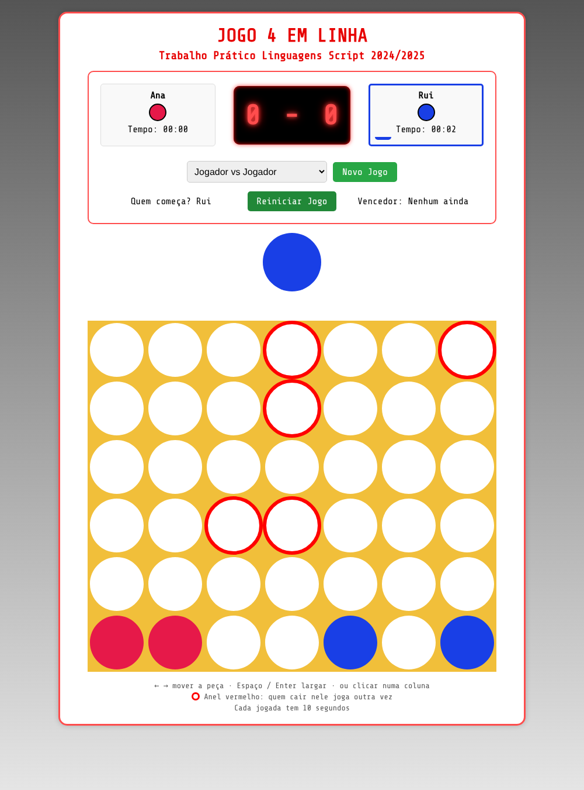
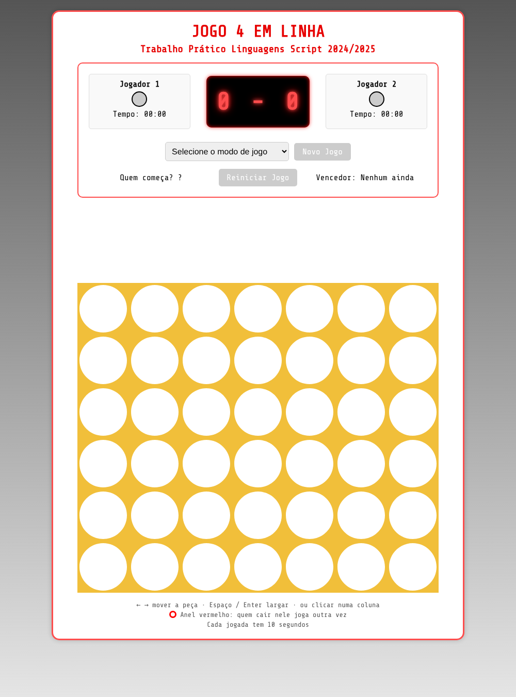
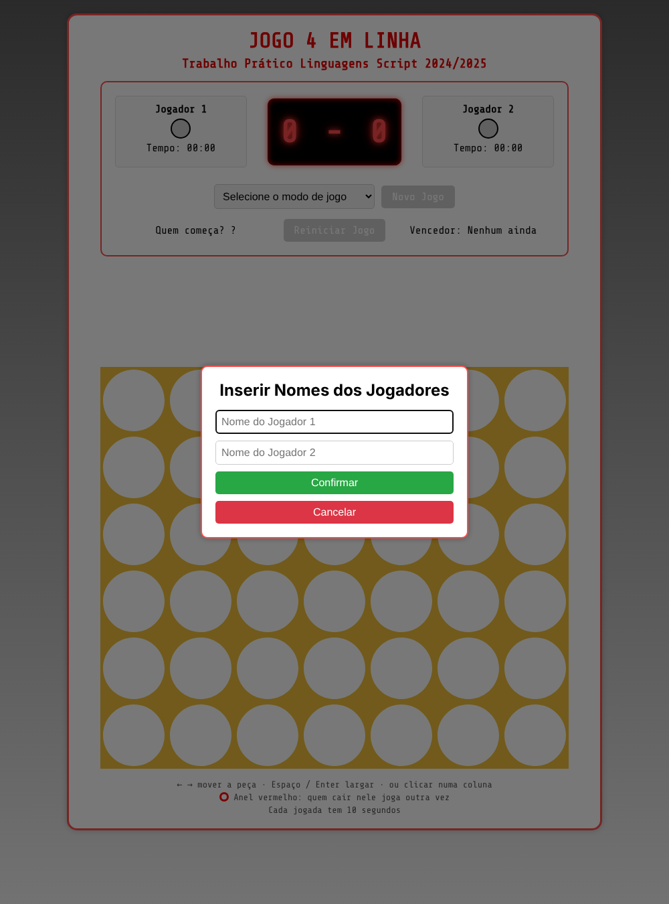
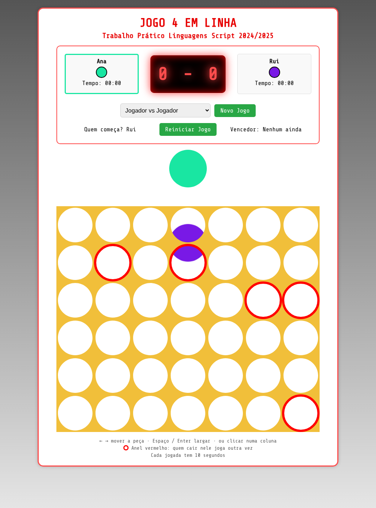
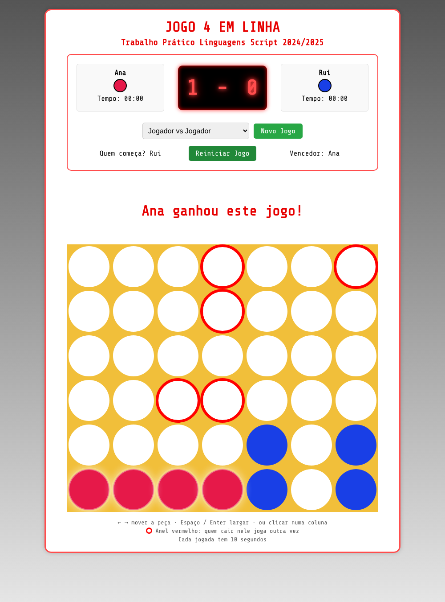
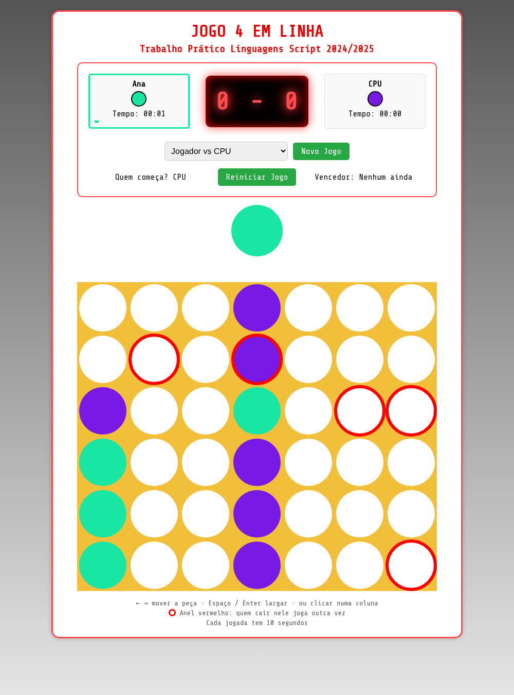
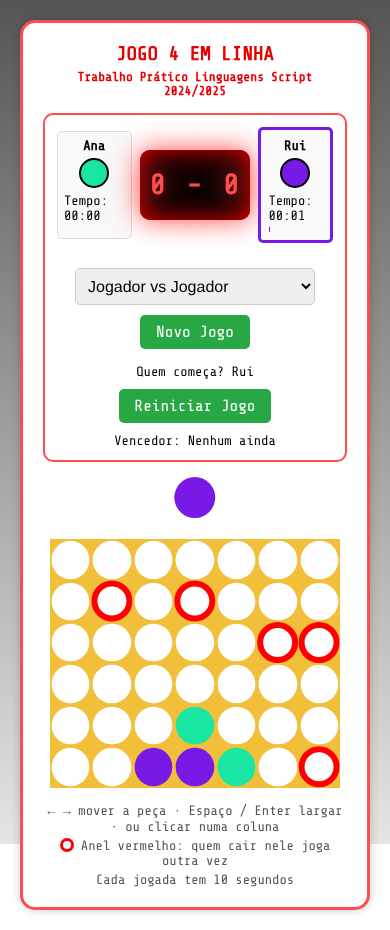

<div align="center">

# 🔴🟡 4 em Linha

**O clássico jogo de estratégia, feito em React, com modo contra o computador, anéis especiais e peças que caem a sério.**




</div>

---

## Índice

- [Sobre o projeto](#sobre-o-projeto)
- [Capturas de ecrã](#capturas-de-ecrã)
- [Regras do jogo](#regras-do-jogo)
- [Como jogar](#como-jogar)
- [Funcionalidades](#funcionalidades)
- [A inteligência do CPU](#a-inteligência-do-cpu)
- [Tecnologias](#tecnologias)
- [Arquitetura e estrutura de pastas](#arquitetura-e-estrutura-de-pastas)
- [Instalação e execução](#instalação-e-execução)
- [Scripts disponíveis](#scripts-disponíveis)
- [Decisões técnicas](#decisões-técnicas)
- [Melhorias futuras](#melhorias-futuras)
- [Contexto académico](#contexto-académico)

---

## Sobre o projeto

Uma versão web do **4 em Linha** (_Connect Four_) para dois jogadores ou para um jogador contra o computador. O tabuleiro tem 7 colunas por 6 linhas, e ganha quem conseguir primeiro alinhar **quatro peças da sua cor**, na horizontal, na vertical ou na diagonal.

Esta versão acrescenta algumas ideias ao jogo original:

- **Células especiais**: anéis vermelhos aleatórios que dão uma jogada extra.
- **Tempo limite** de 10 segundos por jogada.
- **Marcador** com a pontuação de cada jogador ao longo de várias partidas.
- **Cores aleatórias** para os jogadores em cada partida.
- **CPU** que ganha, bloqueia e escolhe jogadas com critério.

O projeto nasceu como trabalho prático da unidade curricular de Linguagens Script (2024/2025) e foi depois revisto, corrigido e melhorado.

## Capturas de ecrã

| Ecrã inicial | Nomes dos jogadores |
| :---: | :---: |
|  |  |

| Peça a cair | Vitória |
| :---: | :---: |
|  |  |

| Modo contra o CPU | Telemóvel |
| :---: | :---: |
|  |  |

## Regras do jogo

1. O tabuleiro tem **7 colunas × 6 linhas** e começa vazio.
2. Os jogadores jogam por turnos. **Quem começa é escolhido ao acaso** em cada partida.
3. Em cada jogada, o jogador escolhe uma coluna e a peça **cai até à posição livre mais baixa** dessa coluna.
4. **Ganha** o primeiro jogador que alinhar **4 peças seguidas** na horizontal, vertical ou diagonal (nos dois sentidos).
5. Se o tabuleiro ficar cheio e ninguém tiver alinhado 4 peças, a partida termina em **empate**.
6. Se a última peça do tabuleiro formar uma linha de 4, **a vitória prevalece sobre o empate**.

### Regras especiais desta versão

| Regra | Como funciona |
| --- | --- |
| 🔴 **Anel vermelho** | Há 5 células marcadas com um anel vermelho, em posições aleatórias e novas em cada partida. Quem largar a peça numa delas **joga outra vez**. |
| ⏱️ **Tempo limite** | Cada jogada tem **10 segundos**. Se o tempo acabar, a vez passa ao adversário e nenhuma peça é largada. A barra por baixo do nome mostra o tempo a passar. |
| 🏆 **Marcador** | A pontuação acumula-se entre partidas, até começares um novo jogo. |
| 🎨 **Cores** | As cores dos jogadores são sorteadas em cada partida, sempre bem distintas entre si e diferentes do amarelo do tabuleiro. |

## Como jogar

### Começar

1. Escolhe o modo no menu **"Selecione o modo de jogo"**:
   - **Jogador vs Jogador**: dois humanos no mesmo ecrã.
   - **Jogador vs CPU**: tu contra o computador (o CPU é sempre o Jogador 2).
2. Escreve o(s) nome(s) (até 14 caracteres) e carrega em **Confirmar**. Podes carregar em **Cancelar** ou na tecla `Esc` para voltar atrás sem perder a partida em curso.
3. A peça do jogador que começa aparece por cima do tabuleiro.

### Controlos

| Ação | Teclado | Rato / toque |
| --- | --- | --- |
| Mover a peça | `←` `→` | Passar o rato sobre a coluna |
| Largar a peça | `Espaço` ou `Enter` | Clicar / tocar na coluna |
| Fechar o modal | `Esc` | Botão **Cancelar** |

Durante a vez do CPU, os controlos ficam desativados.

### Botões

| Botão | O que faz |
| --- | --- |
| **Novo Jogo** | Volta a pedir os nomes, **zera o marcador** e começa uma nova partida. |
| **Reiniciar Jogo** | Recomeça a partida atual com os mesmos nomes e **mantém o marcador**. |

## Funcionalidades

- ✅ Modo **dois jogadores** e modo **contra o CPU**
- ✅ **Animação de queda** com aceleração e pequeno ressalto, com a peça a passar por trás da moldura
- ✅ **Linha vencedora destacada** com um brilho intermitente
- ✅ **Marcador estilo LED** e relógio por jogada com barra de progresso
- ✅ **Células especiais** com jogada extra
- ✅ **Controlo por teclado, rato e toque**
- ✅ **Layout responsivo**, que funciona em telemóvel sem scroll horizontal
- ✅ **Lógica de jogo isolada** da interface e coberta por testes
- ✅ Build de produção sem avisos do ESLint

## A inteligência do CPU

O CPU usa uma heurística simples, que se lê em poucas linhas (`src/logic/game.js`, função `chooseCpuColumn`). Por ordem de prioridade:

1. **Ganhar**: se pode fazer 4 em linha já, fá-lo.
2. **Bloquear**: se o adversário ganha na jogada seguinte, bloqueia essa coluna.
3. **Pontuar as restantes colunas**, escolhendo a melhor:
   - preferência pelas colunas **centrais**, que participam em mais linhas possíveis;
   - bónus por cair numa **célula especial** (joga outra vez);
   - bónus por cada **ameaça de vitória** que a jogada cria;
   - penalização forte se a jogada **oferece a vitória** ao adversário na peça por cima;
   - um pouco de **aleatoriedade**, para as partidas não serem sempre iguais.

> Não é um algoritmo de pesquisa em profundidade (como o minimax), por isso não é imbatível. Planeia apenas uma jogada à frente, e um jogador atento consegue vencê-lo criando duas ameaças em simultâneo.

## Tecnologias

| Área | Tecnologia |
| --- | --- |
| **Linguagens** | JavaScript (ES2022), JSX, CSS3, HTML5, SVG |
| **Biblioteca de interface** | [React 19](https://react.dev/), com _hooks_ (`useState`, `useEffect`, `useRef`) |
| **Ferramentas de build** | [Create React App](https://create-react-app.dev/) (`react-scripts` 5), com Webpack, Babel e ESLint |
| **Testes** | [Jest](https://jestjs.io/) e [React Testing Library](https://testing-library.com/docs/react-testing-library/intro/) |
| **Tipo de letra** | [Share Tech Mono](https://fontsource.org/fonts/share-tech-mono), via `@fontsource` (carrega localmente, sem pedidos externos) |
| **Gestor de pacotes** | npm |
| **Ambiente** | Node.js 18 ou superior (desenvolvido e testado com Node 22) |

**Sem bibliotecas de jogos nem de animação.** As animações são feitas apenas com CSS (`@keyframes`, `transform` e variáveis CSS), e o tabuleiro usa uma máscara em SVG para criar os buracos.

## Arquitetura e estrutura de pastas

```text
Connect-Four/
├── public/                   # Ficheiros estáticos (HTML, favicon, manifest)
├── docs/screenshots/         # Capturas usadas neste README
└── src/
    ├── index.js              # Ponto de entrada
    ├── index.css             # Estilos globais
    ├── App.js                # Estado do jogo, temporizador, modal e ligação dos componentes
    ├── App.css               # Layout geral, modal e tamanho das células
    ├── clip.svg              # Máscara do tabuleiro (moldura com buracos redondos)
    ├── components/
    │   ├── Board.js          # Moldura amarela com os 42 buracos
    │   ├── DropZone.js       # Zona das peças, anéis especiais e linha vencedora
    │   ├── ActiveCoin.js     # Peça ativa: teclado, rato e jogadas do CPU
    │   ├── ControlPanel.js   # Nomes, relógios, marcador e botões
    │   └── Winner.js         # Mensagem de vitória ou empate
    ├── constants/
    │   └── constants.js      # Dimensões do tabuleiro e tempo por jogada
    └── logic/
        ├── game.js           # Regras puras (sem React): vitória, empate, IA, geradores
        └── game.test.js      # Testes da lógica
```

**Separação de responsabilidades:**

- `logic/` é **JavaScript puro**, sem React nem DOM. Isto torna-o fácil de testar e de reutilizar.
- `App.js` guarda o estado e decide **quando** as coisas acontecem.
- Os componentes em `components/` tratam da **apresentação** e da entrada do utilizador.

## Instalação e execução

### Pré-requisitos

- [Node.js](https://nodejs.org/) 18 ou superior (inclui o `npm`)
- [Git](https://git-scm.com/)

### Passos

```bash
# 1. Clonar o repositório
git clone https://github.com/davdoliveira/Connect-Four.git
cd Connect-Four

# 2. Instalar as dependências
npm install

# 3. Arrancar em modo de desenvolvimento
npm start
```

A aplicação abre em <http://localhost:3000>.

> **Nota sobre dependências:** o `react-scripts` 5 só funciona com TypeScript 3 ou 4. Por isso o `package.json` fixa `typescript@^4.9.5`. Sem isto, o `npm` instala a versão mais recente e o build falha. Se o `npm install` queixar-se de conflitos de dependências, usa `npm install --legacy-peer-deps`.

## Scripts disponíveis

| Comando | Descrição |
| --- | --- |
| `npm start` | Arranca o servidor de desenvolvimento com recarregamento automático. |
| `npm test` | Corre os testes em modo interativo. |
| `npm run build` | Gera a versão otimizada para produção na pasta `build/`. |


## Decisões técnicas

- **Lógica separada da interface.** As regras estão em `logic/game.js` como funções puras. Os componentes só chamam essas funções, o que evita duplicar código e permite testar sem renderizar nada.
- **Animações só com CSS.** A posição de cada peça vem de duas variáveis CSS (`--col` e `--row`) definidas pelo React. O CSS calcula a posição com `calc()` e anima a queda com `@keyframes`, sem temporizadores em JavaScript e sem bibliotecas. O tamanho de todas as células vem de uma única variável (`--size`), por isso o jogo escala em telemóvel mudando apenas uma linha.
- **Peças por trás da moldura.** As peças são desenhadas por baixo do tabuleiro, e a moldura (com buracos transparentes) fica por cima. Assim a peça "entra" pelo topo e fica visível através dos buracos, como num jogo físico.
- **Relógio com um único _interval_.** O contador reinicia sempre que cai uma peça, que a vez muda ou que o jogo recomeça, e pára com o modal aberto ou quando a partida acaba.
- **CPU determinista nas jogadas críticas.** Ganhar e bloquear são sempre feitos, e a aleatoriedade só entra na escolha entre jogadas parecidas.
- **Cores em HSL.** Escolher o matiz permite garantir que os dois jogadores ficam bem separados e que nenhum se confunde com o amarelo da moldura.

## Melhorias futuras

- [ ] Dificuldades do CPU (fácil, médio e difícil), com pesquisa _minimax_ com poda alfa-beta
- [ ] Guardar a pontuação e as preferências no `localStorage`
- [ ] Efeitos sonoros
- [ ] Multijogador online
- [ ] Desfazer a última jogada
- [ ] Tema escuro e opções de acessibilidade para daltonismo

## Contexto académico

Projeto desenvolvido no âmbito da unidade curricular de **Linguagens Script** (2024/2025).
